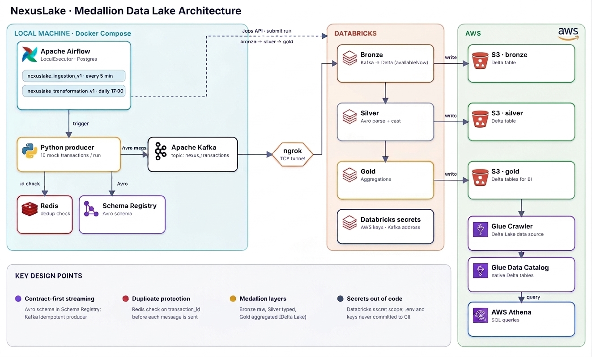

# NexusLake: Medallion Data Lake with Kafka, Airflow, Databricks and Athena



## Overview

NexusLake is an end-to-end data pipeline that follows the Medallion (Bronze / Silver / Gold) pattern.
Mock transactions are produced to Kafka (Avro + Schema Registry) by an Airflow DAG, transformed by
PySpark jobs running on **Databricks serverless compute**, stored as **Delta tables on AWS S3**, and
queried with **AWS Athena** through the Glue Data Catalog.

The setup is hybrid: Kafka, Redis, Postgres and Airflow run locally in Docker, while Spark runs in the cloud.
An **ngrok TCP tunnel** exposes the local Kafka broker to Databricks.

## How it works

1. **Ingestion (Airflow DAG `nexuslake_ingestion_v1`, every 5 minutes):** a Python producer generates 10 mock
   transactions, checks each `transaction_id` in Redis, serializes the message with the Avro schema
   (`src/schemas/transaction_schema.avsc`, registered in Schema Registry) and writes it to the Kafka topic `nexus_transactions`.
2. **Transformation (Airflow DAG `nexuslake_transformation_v1`, daily at 17:00):** three tasks run in order.
   Airflow submits each one to Databricks with the Jobs API (`DatabricksSubmitRunOperator`).
   * **Bronze:** reads new messages from Kafka (through ngrok) and appends the raw records to a Delta table (`availableNow` trigger).
   * **Silver:** reads Bronze, parses the Avro payload and casts types, writes a Delta table.
   * **Gold:** aggregates Silver into `customer_spending_summary` and `currency_stats` (overwrite, Athena-compatible Delta settings).
3. **BI:** a Glue Crawler (Delta Lake data source, native tables) registers the Gold tables in the Glue Data Catalog and Athena queries them with SQL.

### Reliability notes
* Kafka producer runs with `enable.idempotence=true` and `acks=all`.
* Redis keeps an atomic reservation (`SET NX`) per `transaction_id`: confirmed after Kafka acknowledges delivery,
  released on failure so the record can be retried. Reservations expire after 1 hour.
* Spark uses checkpoints in S3. Kafka data is kept in Docker volumes, so topic offsets stay consistent with the checkpoints.
  If you ever delete the Kafka volume, also clear the `checkpoints/` folder on S3, otherwise Bronze fails with
  "offset was changed".

## Project structure

```
dags/                    Airflow DAGs (ingestion, transformation)
src/ingestion/           Mock data generator and Kafka producer
src/processing/          Bronze, Silver, Gold PySpark jobs (run on Databricks)
src/schemas/             Avro schema
src/utils/helpers.py     Paths and secrets (Databricks secrets or environment variables)
infrastructure/          Dockerfile, docker-compose.yml, .env.example
```

## Technologies

Apache Kafka, Confluent Schema Registry (Avro), Redis, Apache Airflow 2.10, PostgreSQL, Docker Compose,
Databricks (serverless), PySpark, Delta Lake, AWS S3, AWS Glue (Crawler, Data Catalog), AWS Athena, ngrok.

## Getting started

### Prerequisites
* Docker and Docker Compose
* AWS account (S3 bucket, Glue, Athena) and an IAM access key
* Databricks workspace (the Free Edition works) and a personal access token
* ngrok account and auth token

### 1. Configure secrets (never commit them)
Create a Databricks secret scope and store the credentials there. The jobs read them at runtime.

```bash
export DBX_HOST=<your-workspace-host>          # e.g. dbc-xxxx.cloud.databricks.com
printf "Databricks token: "; read -s DBX_TOKEN; echo; export DBX_TOKEN

curl -s -X POST "https://$DBX_HOST/api/2.0/secrets/scopes/create" \
  -H "Authorization: Bearer $DBX_TOKEN" \
  -d '{"scope":"nexuslake","initial_manage_principal":"users"}'

put() { printf "$1: "; read -s v; echo; curl -s -X POST "https://$DBX_HOST/api/2.0/secrets/put" \
  -H "Authorization: Bearer $DBX_TOKEN" \
  -d "{\"scope\":\"nexuslake\",\"key\":\"$1\",\"string_value\":\"$v\"}"; }

put aws_access_key
put aws_secret_key
put kafka_bootstrap_servers      # ngrok address, e.g. 0.tcp.eu.ngrok.io:12345
```

### 2. Upload the project to Databricks
Put the `src/` folder in your workspace (a Git folder or `/Workspace/Users/<you>/NexusLake`).
The jobs expect `src/processing`, `src/utils` and `src/schemas` next to each other.

### 3. Start the local stack
```bash
cd infrastructure
cp .env.example .env        # fill in the values
ngrok tcp 9094              # copy the address into NGROK_KAFKA_ADDRESS and into the Databricks secret
docker compose up -d --build
```
`.env` values: `AIRFLOW_CONN_DATABRICKS_DEFAULT`, `NEXUS_DATABRICKS_REPO_PATH`, `NGROK_KAFKA_ADDRESS`.
When ngrok gives you a new address, update `.env`, run `docker compose up -d broker`, and update the
`kafka_bootstrap_servers` secret.

### 4. Run the pipeline
Open Airflow at http://localhost:8080 (default login `admin` / `pass`, change it through `AIRFLOW_ADMIN_PASSWORD`).
Enable and trigger `nexuslake_ingestion_v1`, then `nexuslake_transformation_v1`.
Spark logs for each step are visible on the Databricks run page.

### 5. Query with Athena
Create a Glue database, then a Glue Crawler with two **Delta Lake** data sources
(`s3://<bucket>/gold/customer_spending_summary/` and `s3://<bucket>/gold/currency_stats/`) and
**Create native tables** enabled. The crawler role needs read access to the bucket. Then in Athena:

```sql
SELECT * FROM nexuslake.customer_spending_summary LIMIT 10;
SELECT * FROM nexuslake.currency_stats;
```

## Data quality and tests

Quality rules live in `src/quality/rules.py` (pure Python) and are enforced at three points:

| Where | Check | On failure |
|-------|-------|------------|
| Producer | `validate_record`: non-empty id, positive customer id, amount range, supported currency, sane timestamp | record is skipped and logged |
| Silver | same rules as a Spark condition (`src/quality/spark_checks.py`) | row goes to `quarantine/transactions` on S3 instead of Silver |
| Gold | reconciliation: row counts and total amounts of both Gold tables must equal Silver | job fails **before** writing, Athena never sees bad data |

Run the unit tests locally:

```bash
pip3 install -r requirements-dev.txt
pytest
```

Tests for the Spark condition and the DAG structure run automatically when `pyspark` (and Java) or
`apache-airflow` are installed, otherwise they are skipped.

## Known limitations / roadmap
* Single Kafka broker, no authentication; ngrok address changes on every restart.
* Deduplication happens at the producer and only within the Redis TTL window. Silver does not deduplicate yet, so end-to-end    delivery is at-least-once, not exactly-once.
* Infrastructure is created by hand (no Terraform), no CI.
